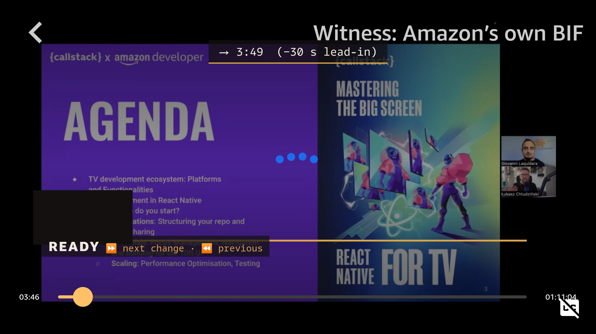
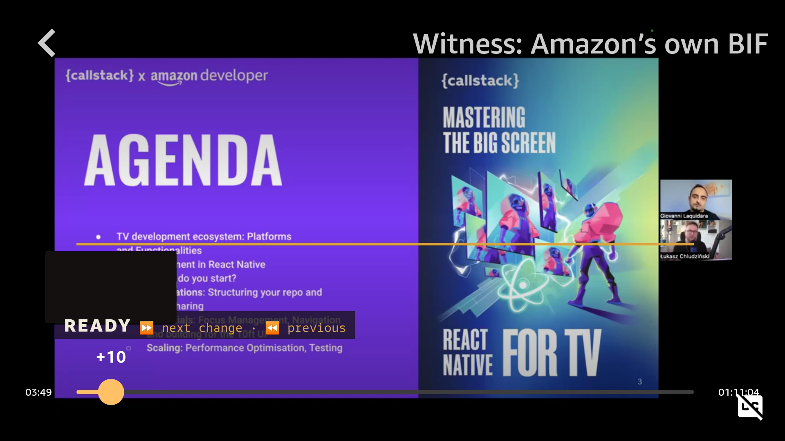
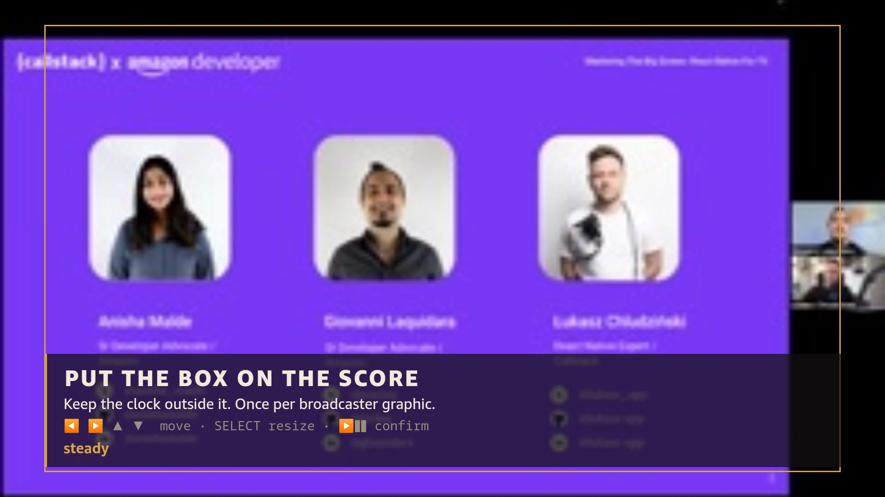

<div align="center">
  
  <h1>Flipbook ⏩</h1>
  <p><em>Skip to just before the next goal on a replay you haven't watched — read from the trickplay file a Vega player already has, without decoding any video.</em></p>
  

  <br/>

  [](https://amazonappdev2026.devpost.com/)
  [](https://flipbook.edycu.dev/)
  [](https://flipbook.edycu.dev/pitch/)
  [](https://youtu.be/AnNfzBMS6Vs)

  <br/>

  
  
  
  [](https://github.com/edycutjong/flipbook/actions/workflows/ci.yml)
  [](https://github.com/edycutjong/flipbook/actions/workflows/codeql.yml)
  [](LICENSE)

</div>

---

## 📸 See it in Action

Running on the **Vega Virtual Device** (Apple M-series Mac). These stills use Amazon's own webinar trickplay file (the "witness"), not a match: it is the title the sample app itself streams, so it shows the engine without any footage of ours.

| Jump | Scrub: the mask over the thumbnail |
|---|---|
|  |  |



## 💡 The Problem & Solution

### The Problem
You come home to a full-match replay of a game you haven't seen (a lower-division, women's or amateur match). The seek bar has no chapters. Scrubbing shows you the score on every thumbnail, so you spoil the result while you hunt for the goals.

### The Solution
A player that shows scrub previews from BIF trickplay — as Amazon's Vega video sample does — already downloads a **BIF** file: one small JPEG per ~10 s of the match. Flipbook reads that file instead of the video:

1. **Calibrate once** — draw a box around the broadcaster's score graphic (it is remembered per broadcaster).
2. **Scan** — a two-pass change-and-hold detector compares the box across thumbnails. Pass 1 samples sparse frames so the first ticks appear fast; pass 2 reads every frame to fill gaps and refine. Only a change that *holds* counts, so a replay or a brief graphic dropout does not (shown in synthetic tests; the development match has no replay).
3. **Jump** — ⏩ goes to the next change minus a lead-in (default 30 s), anchored on the last frame that still shows the **old** score, so you land before the play.

Two modes, **blind by default**: the seek bar shows only your position and how far the scan has read, and the thumbnails' score rectangle is masked. **Highlights** (user-selected) adds ticks on the seek bar. Either way, no video is decoded, by construction: the scan only opens the BIF's thumbnail JPEGs (the benchmark's `videoBytesDecoded` is fixed at 0 by its result type; `verify:offline` bounds the JPEG bytes decoded by the BIF's size).

## 🏗️ Architecture & Tech Stack


<details>
<summary>Text version</summary>

```
BIF service (sample) ──same bytes, via PlayerScreen──► core/bifIndex.ts (validated reader)
  ──► luma.ts (jpeg-js) ──► signature.ts (64×5 grid) ──► detector.ts (change must hold)
  ──► scan.ts (pass 1: every 8th + bisect · pass 2: all · ≤ 8 decodes per JS turn) ──► markers

markers ──► FlipbookContext ──► KUI SeekBar: score-box mask (always) · ticks (highlights only)
⏩/⏪ ──► FlipbookContext ──► core/jump.ts (anchor − 30 s) ──► VideoPlayer.currentTime
```

</details>

| Layer | Choice |
|---|---|
| Platform | Vega OS (Fire TV), React Native, TypeScript |
| Player | W3C `VideoPlayer` + Shaka Player (from the sample) |
| Detector | Arithmetic change-and-hold on a calibrated rectangle — no ML, no LLM (`src/flipbook/core/`) |
| Detector signature | 64×5 grid, jitter mask, top-3 cell distance, 3-frame median hold (v2; replaced a 16×4 mean-abs signature) |
| Decode | `jpeg-js` 0.4.4 on the device |
| Persistence | AsyncStorage (box per broadcaster) |
| Starting point | A copy of [AmazonAppDev/vega-video-sample](https://github.com/AmazonAppDev/vega-video-sample) at `ef8e4da` (MIT-0; upstream history not kept, so not a GitHub fork) |

## 🏆 Fire TV (Vega) Integration

The judged path uses **four platform surfaces** at runtime, plus Amazon's reference BIF service — sample code we extended to hand over the raw bytes (not a platform API) — and the Vega tooling:

| Surface | Used for |
|---|---|
| W3C `VideoPlayer` (`@amazon-devices/react-native-w3cmedia`) | playback; `currentTime` set by the jump |
| KUI `SeekBar` | blind/highlights seek bar: `markers` prop for ticks, `displayAboveThumb` overlay masking the score area; `partialDisablingConfiguration` hands ⏩/⏪ to Flipbook |
| TV input and focus (`useTVEventHandler`, `TVFocusGuideView`) | `useTVEventHandler`: ⏩/⏪ fast-forward and rewind keys and calibration (arrows move, PLAY/PAUSE or BACK confirms, MENU opens the panel); SELECT is read through the focused seek bar, because the platform consumes it before `useTVEventHandler` (friction #16); `TVFocusGuideView`: keeps focus on the seek bar. While Flipbook is on, ⏩/⏪ jump between changes instead of skipping; LEFT/RIGHT on the focused seek bar are left to the KUI SeekBar |
| AsyncStorage (`@amazon-devices/react-native-async-storage__async-storage`) | remembers the calibration box per broadcaster across relaunches |
| Vega Virtual Device + CLI (tooling, not runtime) | build, run, on-device logs and recordings |
| Amazon's BIF service in the sample (`src/services/bif/*`) | downloads the BIF; one added call (`getBifFile`) hands Flipbook the same bytes, which its own validated parser reads (`src/flipbook/core/bifIndex.ts`); its header and parser defects are entries 6–7 of [`FRICTION_LOG.md`](FRICTION_LOG.md) (18 entries in all) |

Found while verifying: Amazon's own `tv-webinar-hd.bif` has 428 frames (the first checked at 240×180) and a timestamp-multiplier field of `0xFFFFD8F0` (−10,000 if read as a signed 32-bit number), so a binary search by `positionMillis` would break Amazon's file. Flipbook sanity-checks the header and, when the multiplier is not sane, derives the unit from the player's video duration, or 10 s per frame when no duration is known.

The [Kiro](https://kiro.dev) CLI wrote `scripts/make-bif.ts`, `src/flipbook/core/bifWriter.ts` and their tests (18) headless (see the commit history). A `kirocrew run` attempt produced nothing (approval policy and rate limits); that is recorded, not claimed. The Amazon Devices Builder Tools MCP was installed into Kiro (`init-context --agent kiro`) and Kiro called its `list_documents`, `set_project_context` and `search_documentation` tools to return the SeekBar `markers` and `partialDisablingConfiguration` docs; no perfetto trace was analysed. Details and logs: [`docs/KIRO.md`](docs/KIRO.md). All 18 friction-log entries are in [`FRICTION_LOG.md`](FRICTION_LOG.md).

## 📊 Engineering Rigor

| Metric | Value | Source |
|---|---|---|
| Tests | 444 passing + 4 skipped (76 suites + 1 skipped), 93 of them Flipbook; `tsc` clean | `npm test`, `npm run typecheck` |
| Video bytes decoded | 0, by construction (the scan only opens BIF JPEGs); `videoBytesDecoded` is fixed at 0 by the result type, and `verify:offline` checks that the JPEG bytes decoded stay within the BIF's size (6,571,356 of 6,575,564 bytes at 320 px, output kept in `evidence/bench/verify-offline.txt`) | `src/flipbook/core/scan.ts`; `scripts/verify_offline.ts`; `evidence/bench/verify-offline.txt`; `evidence/bench/*.json` |
| On the Vega Virtual Device, pass 1 (Amazon's BIF; detector v1 build 5be6a4a, before the v2 signature) | 203 of 428 frames in 4,085 ms (≈ 20 ms per decoded frame); that run used a box over most of a webinar frame with no score graphic, so its 34 pass-1 markers are not detections | `evidence/vvd/README.md`, `witness-v1-flipbook-lines.log` |
| On the Vega Virtual Device, jump without stacked seek | `seek from=50572ms currentTime=199.1`, then `currentTime=199.1` 1.5 s later | `evidence/vvd/witness-v1-flipbook-lines.log` |
| Development match (agent dev labels, **not ground truth**) | 2/2 changes found, 0 false markers, 2/2 jumps land before the play (leads 28 s and 30 s); pass 1 reads 14.9 % of frames | `evidence/bench/dev-winchester-320.json` |
| Visibility margin (dev labels) | 2.64× at 320 px, 2.04× at 240×180 letterboxed | `evidence/bench/visibility-dev-winchester-*.json` |
| Fair baseline | a plain frame differ finds 2/2 only at τ ≤ 30 (of the 8–80 we swept; τ = 40 finds none); at τ = 30, the best of those, it fires 237 false markers | `evidence/bench/dev-winchester-320.json` → `ablationBaseline` |
| On the Vega Virtual Device, development match (detector v2, calibrated with the D-pad), 19 relaunch runs | pass 1 reads 77 of 517 frames: p50 2,771 ms, p95 3,422 ms; pass 2 p50 14,294 ms, p95 17,796 ms; the box is restored from AsyncStorage after each relaunch; same two markers as the Node run | `evidence/vvd/README.md`, `evidence/bench/dev-winchester-320-vvd.json` |
| Node timings (not device) | pass 1 p50 210.8 ms, pass 2 p50 1,229.6 ms over 20 runs, labelled "Node (tsx) on Apple M-series" | `evidence/bench/dev-winchester-320.json` |

Always read pass 1 and pass 2 together: pass 1 reads 14.9 % of frames only to put the first ticks up quickly; pass 2 still reads every frame.

### Attacks defeated

Each control exists because a malformed or hostile input, or a timing slip, would otherwise break the player. Every row has a test.

| Control | Why it is load-bearing | Test |
|---|---|---|
| 1 MP JPEG cap, checked at the frame header | one oversized "thumbnail" would pin the single JS thread inside `jpeg-js` | `test/flipbook/scan.test.ts:91` |
| A rejected box (moving, graphic not found, failed scan) turns seek thumbnails off | otherwise the unmasked preview would show the score the mask exists to hide | `test/flipbook/ui.test.ts:114` |
| A BIF that lands after the player unmounted starts no scan | a late attach would run the detector and write the saved box for a screen that is gone | `test/flipbook/lifecycle.test.tsx:69` |
| At most 8 decodes per JS turn, bar probes included | the scan must not starve the UI and key handling | `test/flipbook/scan.test.ts:62` |
| BIF header and offset validation (terminator entry, truncation, offsets outside the file, non-BIF bytes, Amazon's `0xFFFFD8F0` multiplier) | the sample parser only warns; a bad file would feed garbage offsets to the decoder | `test/flipbook/bifIndex.test.ts:28`, `:50`, `:56`, `:63` |
| "Still reading — no later change yet" while pass 2 can still add a change | a premature "no later change" would be a false negative stated as final | `test/flipbook/ui.test.ts:129` |
| One BIF download per open | the surface is created twice; two downloads would double the bytes and race two scans | `test/flipbook/playerBifFetch.test.tsx:85` |

### Honest limits (9)

1. **Virtual device only.** No Fire TV hardware was available; every on-device timing is from the Vega Virtual Device on an Apple M-series Mac; the benchmark timings are Node (tsx), not device.
2. **The held-out headline is pending.** The headline metric (goal jumps that land before the play on held-out match B) will be reported only after the human's ground-truth files for matches A and B are committed. Until then no such number is claimed. Detector parameters and calibration boxes are frozen in [`fixtures/PREREG.json`](fixtures/PREREG.json) (detector-params sha256 `6f21e417…`), and `bench`/`visibility` refuse to run on matches A and B without a committed truth file.
3. **The numbers above come from one development match with two labelled changes**, labelled by the detector's author (an AI agent, Claude Code) from 2 s stills. The 95 % confidence interval on 2/2 is [0.158, 1]. It shows the pipeline works, not how well it generalises.
4. **Same producer.** Matches A, B and the development match are all Belmont Media Center broadcasts; B has a different overlay design. Read it as "tuned on one match, tested on two more from the same producer."
5. **Disclosure:** to place the calibration boxes the detector's author (the same AI agent) looked at one 2:00 frame of each of A and B; no detector run has been made on either.
6. **Blind mode still discloses** that a jump reveals a change ahead; "No later change" reveals none; misses are silent.
7. **Scrubbing is coarse:** one thumbnail per ~10 s. A leaked score in the video itself (not the graphic) is outside what the mask covers.
8. **On-device scope.** The calibrated scan, 19 relaunch timings and the box restored after a relaunch are captured on the VVD for the development match only (matches A and B were never scanned). Still not measured on the device: a dedicated 100-frame decode median. The VVD stopped drawing text after about 20 minutes of uptime (friction entry 18), and earlier would not boot once the Mac's screen locked (the lock is the most likely cause; not proven); see `evidence/vvd/README.md`.
9. **Footage rights.** The three matches are CC0 1.0 on the Internet Archive and show high-school students and school marks; the marks are the schools', not ours, and CC0 does not cover trademarks. We mute the original commentary in everything we publish and use no close-ups.

## 🚀 Getting Started

### Prerequisites

- [Vega Developer Tools](https://developer.amazon.com/docs/vega/latest/install-vega-sdk.html), Node 20 (what the on-device build was verified with; CI runs Node 22, `engines` is `>=22`), JDK 21, Python 3 (the Shaka postinstall needs them)
- Never build from a path that contains a directory named `assets` (the packager embeds host paths and breaks)

### Installation

```bash
npm install                       # also builds Shaka (postinstall)
npm run build:release             # → build/aarch64-release/*.vpkg on Apple M-series
vega virtual-device start --gui
vega run-app build/aarch64-release/keplervideoapp_aarch64.vpkg   # x86_64 hosts: build/x86_64-release/…
```

The "Matches" row plays development media from a local static server (rebuild steps: [`DEMO.md`](DEMO.md)) and BIFs from `fixtures/`; the "Witness" row streams Amazon's BIF from the sample's own CDN. Build your own BIF from any video with `npm run make-bif`.

## 🧪 Testing & CI

```bash
npm run typecheck
npm test                                  # 444 passing + 4 skipped (93 Flipbook)
npm run test:flipbook                     # Flipbook only
npm run bench                             # development-match benchmark, 20 runs, with ablations
npm run trace                             # the scan's read order and per-frame change distance (the landing page replays it)
npm run verify:offline                    # offline checks of the BIF pipeline
```

GitHub Actions runs on every push to `main` and every pull request (`.github/workflows/`):

- **CI**: `npm ci --ignore-scripts`, typecheck, lint, Jest with the coverage thresholds, `verify:offline`, and `actionlint` on the workflows
- **Security**: gitleaks over the full history, plus a report-only `npm audit` of production dependencies (the open advisories are in the sample's dependencies — its React Native CLI chain, `xmldom` and others — not in Flipbook's own code)
- **CodeQL**: JavaScript/TypeScript analysis; results upload to code scanning

Dependabot is limited to patch and security updates because the dependency set is pinned to the Vega toolchain. See [SECURITY.md](SECURITY.md).

## 📁 Project Structure

```
src/flipbook/core/     BIF index + writer, luma, signature, detector, two-pass scan, jump
src/flipbook/app/      context, overlay (calibration, panel), SeekBar parts
scripts/               bench, visibility, trace, make-bif, verify_offline
fixtures/              BIFs for the development match and matches A/B, PREREG.json, truth template
evidence/              bench JSON and on-device VVD logs behind every number above
tools/label/           the human ground-truth labelling page
docs/                  the landing page and pitch deck (GitHub Pages), with the media they use
test/flipbook/         Jest invariants
```

## 🗺️ Roadmap

- [x] BIF → decode → two-pass detector → markers → ⏩ jump on the VVD
- [x] Blind and highlights modes, masked thumbnails, calibration overlay
- [x] Pre-registered parameters and held-out guard
- [ ] Human ground truth for matches A and B, then the held-out result
- [x] Calibrated on-device recording of the development match
- [ ] Upstream the BIF parser fixes to `vega-video-sample`
- [ ] A packaging-time scan, so a provider can run the detector once where the BIF is made

## 📽️ Demo Materials

- **Demo video (2:54):** https://youtu.be/AnNfzBMS6Vs — recorded on the Vega Virtual Device: calibrate, scan, jump, in Blind and Highlights mode
- **Landing page:** https://flipbook.edycu.dev/
- **Pitch deck:** https://flipbook.edycu.dev/pitch/

## 📄 License

[MIT-0](LICENSE) (inherited from the Amazon sample). Third-party notices: [`LICENSE-THIRD-PARTY`](LICENSE-THIRD-PARTY).

## 🙏 Acknowledgments

Built on [AmazonAppDev/vega-video-sample](https://github.com/AmazonAppDev/vega-video-sample). Match footage recorded by Belmont Media Center and released CC0 1.0 on the Internet Archive; item links, SHA-1s and our obligations are in [`CREDITS.md`](CREDITS.md). `jpeg-js` is BSD-3-Clause.
